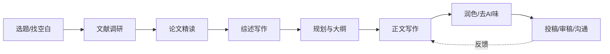

# 🔬 Research Copilot · 科研副驾驶

> 一个面向**实验类理工科研究生**的科研全流程 Agent Skill：从选题、调研、精读到综述、论文写作、润色、审稿与投稿，把成熟的科研方法论固化为可复用的工作流。

[](LICENSE)
[]()
[]()

## ✨ 这是什么

Research Copilot 是一个结构化的 **Agent 技能（Skill）**。它不是单点工具，而是把「**选题 → 调研 → 精读 → 综述 → 规划 → 写作 → 润色 → 审稿/回复 → 投稿/汇报**」九个环节的成熟做法整合成一条完整链路，并在每个环节设置质量门（quality gate）。

- **综述与原创实验论文都覆盖**：综述写作与实验类科技论文共用同一套「证据边界 + 质量控制」底层方法。
- **为实验学科适配**：特别适配材料、化工、机械等领域——把通用方法论中的"方法 / 指标"落实为材料体系、制备与焊接工艺、表征手段、性能数据。
- **按需加载**：主文件负责路由，各环节细节放在独立 reference 中，用到才读，不浪费上下文。

## 🧭 能力地图

| # | 环节 | 你可以让它做什么 |
|---|---|---|
| 01 | 选题与研究空白 | 判断想法新不新颖、辨析真/伪 gap、评估创新性、可行性与风险 |
| 02 | 文献调研 | 三轮系统检索、构造检索式、建立文献库、证据分级 |
| 03 | 论文精读 | 生成结构化精读卡、判断值不值得读、识别复现难点 |
| 04 | 综述写作 | 写综述 / related work、方法分类与演化、文献横向对比 |
| 05 | 论文规划与大纲 | 选期刊、学样稿、设计章节、审稿人视角自评 |
| 06 | 论文正文写作 | 写引言/实验/结果/讨论/结论/摘要，逐章质量控制 |
| 07 | 润色与去 AI 味 | 精简、去 AI 腔、把论断与证据对齐 |
| 08 | 投稿、审稿与沟通 | cover letter、rebuttal、模拟审稿、组会周报、报告海报、机制图 |

## ▶️ 安装

本技能遵循通用 Agent Skill 目录约定（一个文件夹含 `SKILL.md` 与 `references/`）。

1. 下载本仓库，将其中的 **`research-copilot/`** 文件夹复制到你的 Agent 技能目录：
   - 豆包 / Doubao：放入 `.user_skills/`（随后会出现在技能面板"由我创建"）。
   - Claude Code / Codex 等兼容 Agent：放入其对应的 `skills/` 目录。
2. 重启会话或刷新技能列表。
3. 直接用自然语言交代科研任务，Agent 会自动判断所处环节并触发，**无需手动指定技能**。

## 💬 使用示例

- “帮我判断『某焊接热输入下环焊缝低温韧性』这个方向新不新颖、能不能做。”
- “精读这篇论文，做一张中文精读卡。”
- “写我那篇综述的引言第一段，并说明覆盖范围。”
- “模拟审稿人，挑挑我这节 Results and Discussion 的硬伤。”
- “把这段去去 AI 味，检查每个论断有没有数据支撑。”
- “帮我逐条回复这两位审稿人的意见，区分要补实验还是做澄清。”

## 📁 目录结构

```
research-copilot/
├── SKILL.md                     # 主入口：路由中枢 + 三条铁律
└── references/
    ├── 01-选题与研究空白.md
    ├── 02-文献调研.md
    ├── 03-论文精读.md
    ├── 04-综述写作.md
    ├── 05-论文规划与大纲.md
    ├── 06-论文写作.md
    ├── 07-润色与去AI味.md
    └── 08-投稿审稿与学术沟通.md
```

## 🧱 三条铁律（贯穿全程）

1. **证据边界不可越**：没读全文就声明，没做的实验不写成已做，没有的数据不编造；每个论断都能指向数据、图表、文献或实验。
2. **先结构，后字句**：沿「文档结构 → 段落 → 句子 → 词语 → 标点」漏斗推进，"写"与"改"分开。
3. **每环节有质量门**：不达标不进入下一步，先用审稿人视角自评再交付。

## 🔄 全流程



## 🙏 方法论来源与致谢

本技能是**综合与再创作**，提炼、融合并改造自以下开源科研技能项目（版权归原作者所有，遵循其各自许可）：

- [lishix520/academic-paper-skills](https://github.com/lishix520/academic-paper-skills) — 三阶段规划、三轮检索、审稿人自评、逐章质量门
- [chtc66/academic-skills](https://github.com/chtc66/academic-skills) — 综述、研究空白、精读、rebuttal 子技能
- [AIScientists-Dev/academic-humanizer](https://github.com/AIScientists-Dev/academic-humanizer) — 学术去 AI 味与论断—证据纪律
- [YuanZHAO321/Scientific-Writing-zh](https://github.com/YuanZHAO321/Scientific-Writing-zh) — 中文科研写作漏斗与 CPR 修改法
- [zLanqing/codex-claude-academic-skills](https://github.com/zLanqing/codex-claude-academic-skills) — 信息分类与章节修辞结构

已剔除原项目中偏特定学科（哲学 / 预印本 / NLP）的口径，并针对实验类理工科做了适配。

## ⚠️ 免责声明

- 本技能提供方法论，**不替代目标期刊的 Instructions for Authors** 与学科权威规范。
- “去 AI 味”不用于规避 AI 使用披露；若期刊要求，应按规定如实声明。
- 任何环节都不编造数据、结果、文献、基金或合作信息；最终学术判断与责任在作者。

## 📄 License

[MIT](LICENSE)
